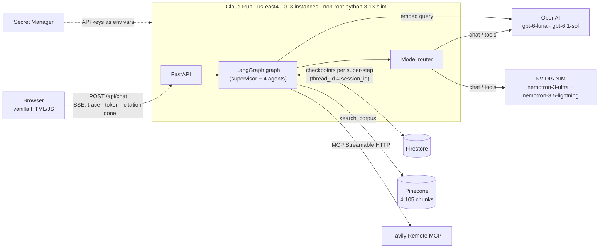
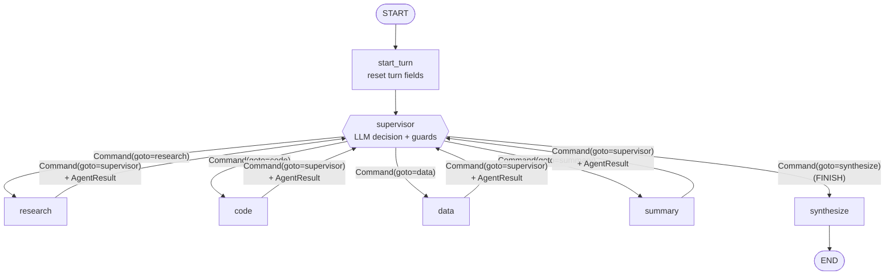

# Architecture

A LangGraph **supervisor** routes each user turn to four specialist agents (Research, Code, Data, Summary). Generation is routed across **two LLM providers (OpenAI and NVIDIA NIM)** by an inspectable policy. Retrieval runs over a **Pinecone** corpus of 58 arXiv papers plus the LangGraph, MCP and A2A docs. Live knowledge comes from **Tavily Remote MCP**, whose tools are shared by three agents. Conversation state is **checkpointed to Firestore**, and the whole thing runs on **Cloud Run** behind a FastAPI + SSE vanilla-JS UI.

## 1. System context



The container holds only code and a 228 KB read-only SQLite file. Everything stateful lives outside it: vectors in Pinecone, conversations in Firestore, keys in Secret Manager. That makes any instance disposable.

## 2. Orchestration graph



**Pattern: supervisor (hub and spoke).** On every hop, the supervisor sees the conversation, the user's request and the results so far (each in full up to 6,000 characters; with only an 800-character preview it kept re-running agents to "finish" answers whose key facts were past the cut). It returns a structured `SupervisorDecision` with these fields:
- `next`: an agent, or FINISH
- `task`: a self-contained instruction for that agent
- `complexity`: low / medium / high
- `reason`: shown in the trace
- `direct_answer`: only for greetings or questions about the assistant itself

Deterministic **guards** can override the LLM:
- hop limit 6 → FINISH
- same (agent, task) twice → FINISH
- an agent failed twice → FINISH
- the supervisor's own call failed → Research on the first hop, FINISH afterwards
- FINISH on the first hop with no `direct_answer` → asked once more with the reason; if still empty, Research

Every decision is appended to `state.routes` and emitted as an `agent_route` trace event, with `decided_by: llm | guard: <why>`.

**Workers** run a bounded tool-calling (ReAct) loop: 4–6 rounds, after which a final round withholds tools to force a text answer. They return to the supervisor. A reply that cites nothing after searching (a "Let me search…" preamble) gets one forced answer round. If the answer is still uncited, the sources the agent read are appended as "Sources consulted", so every answer links back to its sources. Any exception inside a worker, including a 120 s timeout, becomes `AgentResult(status="error")`, so a failed agent never crashes the graph and the supervisor routes around it.

**Synthesis** depends on how the turn went:
- **One agent succeeded:** its answer passes straight through, with no extra LLM call.
- **Several agents succeeded:** an LLM merges them, keeping every `[S#]` / `[W#]` label.
- **Every agent failed:** an explicit error answer.

A typical multi-agent turn: *"Which RAG paper in the corpus has the most citations? Summarize it."* → `data` (SQL) → `summary` (fetches the paper it found) → `synthesize`.

## 3. State schema (`src/graph/state.py`)

| Field | Type | Reducer | Scope | Purpose |
|---|---|---|---|---|
| `messages` | `list[AnyMessage]` | `add_messages` | **conversation** (persists across turns) | User turns and final answers; follow-ups are resolved from it |
| `query` | `str` | overwrite | turn input | The current request |
| `policy` | `str` | overwrite | turn input | `economy` / `balanced` / `quality` (model-routing policy, chosen in the UI) |
| `forced_provider` | `str \| None` | overwrite | turn input | Evaluation only: forces every role onto one provider |
| `routes` | `list[RouteRecord]` | `reset_or_append` | turn (reset by `start_turn`) | Supervisor decisions: `hop, next, task, complexity, reason, decided_by` |
| `results` | `list[AgentResult]` | `reset_or_append` | turn | One per agent run: `agent, task, status, output/error, cited, provider, model, slot, tools_used, latency_s, tokens, cost_usd, llm_calls` |
| `sources` | `dict[label, Source]` | `reset_or_merge` | turn | Shared citation registry: `[S#]` corpus chunks (doc, section, pages, score), `[W#]` web pages. Excerpts are capped at 4,000 characters (see §7). |
| `hops` | `int` | overwrite | turn | Supervisor hop counter (limit 6) |
| `final_answer` | `str` | overwrite | turn output | What the UI renders |
| `turn_stats` | `dict` | overwrite | turn output | Mode, agents, hops, providers, tokens, USD cost |

The turn fields use a reducer where `None` means "reset". `start_turn` writes `None` to clear them, while `messages` keeps accumulating, so the conversation persists but each turn starts with a clean workspace.

## 4. Agents: responsibilities and tool access

| Agent | Responsibility | Tools (its own set) | Typical model (balanced) |
|---|---|---|---|
| **Supervisor** | Pick the next agent and write its task; decide when to finish | none (structured output) | `gpt-6-luna` |
| **Research** | Conceptual and technical questions: corpus first, web for current information; specific questions about a named paper | `search_corpus` (Pinecone), `web_search` + `web_extract` (Tavily MCP) | `nemotron-3-ultra` (thinking mode on when complexity is high) |
| **Code** | Write or fix Python for LangGraph, LangChain, MCP and RAG | `search_code_examples` (Pinecone, code-only filter), `web_search` (Tavily MCP), `check_python_syntax` (`ast.parse`, never executes) | `nemotron-3-ultra` |
| **Data** | Counting, ranking and filtering over corpus metadata and model prices | `list_tables`, `describe_table`, `run_sql` (read-only SQLite) | `gpt-6-luna` |
| **Summary** | Summarize one whole paper, docs page or URL | `find_document`, `fetch_document` (whole document by ID prefix), `web_extract` (Tavily MCP) | `gpt-6-luna` to locate, then `nemotron-3-ultra` once the document is in context (> 30k tokens) |

`run_sql` is safe by construction:
- The database is opened read-only (`mode=ro`).
- A SQLite authorizer allows only SELECT/READ/FUNCTION.
- Only a single statement is accepted.
- A VM-step budget and a 50-row cap apply.

### MCP tool sharing between agents (10% criterion)
The system connects to the **Tavily Remote MCP server** over **Streamable HTTP** at `https://mcp.tavily.com/mcp/?tavilyApiKey=…`, the key passed as a query parameter. It uses `langchain-mcp-adapters`' `MultiServerMCPClient`, and one process-wide client (`src/mcp_client.py`) discovers the server's tools once and caches them.

The same MCP tools are shared by three agents, each using them in a different context:

| MCP tool | Used by | Context |
|---|---|---|
| `tavily_search` | Research | current events, releases, anything newer than the corpus |
| `tavily_search` | Code | current library versions and API changes |
| `tavily_extract` | Research | reading the authoritative page for an exact current fact, e.g. a PyPI release page |
| `tavily_extract` | Summary | summarizing a URL |

Every call emits an `mcp_tool_call` trace event carrying the calling `agent`, `server`, `tool`, arguments, status, result count and latency, so the sharing is visible in the UI's Trace tab.

**Evidence from the deployed system** (revision `00009`, 2026-10-27; `mcp_tool_call` events from the live trace):

| Request | Agent → MCP tool calls (context) |
|---|---|
| "Check the current langchain-mcp-adapters version on PyPI, then write a minimal Python example that connects MultiServerMCPClient to a streamable HTTP MCP server…" | **research** → `tavily_search` ×3 + `tavily_extract` ×1 (find the current version and API); then **code** → `tavily_search` ×1 (check the API while writing code). The same tool, used by two agents in one turn for different purposes. |
| "What changed in the most recent langgraph release on PyPI, and when was it published?" | **research** → `tavily_search` ×2, `tavily_extract` ×2 (search excerpts, then read the PyPI page) |
| "Summarize this page: https://docs.tavily.com/documentation/api-credits" | **summary** → `tavily_extract` ×1 (fetch the page to summarize). The extract tool is shared with Research, which uses it to read authoritative pages. |

**Why MCP rather than A2A:** the shared capability is a *tool* (search and extract), which is exactly what MCP standardizes. A2A connects independent *agents*, possibly owned by other teams, which this single-application system doesn't need. The A2A docs in our own corpus describe MCP as "vertical" (deepening one agent) and A2A as "horizontal" (connecting agents across boundaries).

## 5. LLM routing

There are two separate routing decisions:
1. **Which agent** runs next: the supervisor, an LLM call (§2).
2. **Which model** serves each LLM call: `src/llm/router.py`, deterministic rules. The supervisor's only input to this is its `complexity` rating.

### Routing table: balanced policy (default)
Rules are evaluated in order; the first match wins.

| Call | Slot (model) | Dimension | Rationale (from the Phase 0 benchmark, `data/bench/`) |
|---|---|---|---|
| Supervisor (every hop) | `openai:fast` (gpt-6-luna) | **latency** | 100% routing accuracy, 1.7 s; runs on every hop, so speed matters most |
| Summary, input > 30k tokens | `nvidia:strong` (nemotron-3-ultra) | **capability** | 1M context window, and free, while OpenAI cost scales with input size |
| Summary, short input | `openai:fast` | **cost** | Cheapest reliable tool-caller for locating the document |
| Research, high complexity | `nvidia:strong` + thinking | **capability** | Multi-hop questions get Nemotron's reasoning mode; free |
| Research | `nvidia:strong` | **cost** | Free, 100% tool accuracy, 1.5 s TTFT |
| Code | `nvidia:strong` | **cost** | Strong and free |
| Data | `openai:fast` | **capability** | Precise text-to-SQL, cheapest reliable model |
| Synthesizer, high complexity | `nvidia:strong` + thinking | **capability** | Hard merges get the reasoning mode; free |
| Synthesizer | `nvidia:strong` | **cost** | Routine merge, free |

**Other policies** (switchable in the UI):
- **Economy** sends everything to NVIDIA, with Lightning (`nvidia:fast`) as the supervisor.
- **Quality** sends all agent work to `openai:strong` (`gpt-6.1-sol`). This is the only way `gpt-6.1-sol` runs; a test enforces that the balanced policy never selects it, even during an NVIDIA outage.

**Adjustments applied to every decision:**
1. **Availability:** a per-provider circuit breaker. A 429, 5xx, timeout (60 s per call; the slowest of 1,004 successful calls took 51 s), dropped connection or empty completion opens it for 60 s; the call is retried once on the other provider, and the trace records `llm_error` plus the new `llm_route` with dimension `availability`. Falling back to OpenAI always uses `gpt-6-luna` (100% tool accuracy in the benchmark), so an NVIDIA outage can't drain a prepaid OpenAI credit.
2. **Rate limit:** a sliding-window limiter keeps NVIDIA's free tier under 35 requests per minute, otherwise the call falls back to OpenAI.
3. **Context window:** slots that would be over 90% full are skipped. The router re-checks before every call, so the Summary agent switches models mid-task once a 40k-token paper is loaded.
4. **Capability-aware fallback:** tool-using roles never fall back to Lightning, which had 0% tool-call accuracy with thinking off.
5. **Reasoning budget:** Nemotron's thinking mode is enabled only for high-complexity research, code or synthesis. With thinking on it was 5–10× slower and no more accurate on routine work.

**Inspectability.** Every model decision is emitted as `llm_route` (role, policy, complexity, slot, provider, model, **dimension**, **rule**, **reason**, estimated cost). Every call is emitted as `llm_call` (latency, tokens, USD). In the UI:
- each turn shows chips like `research · nemotron-3-ultra (NVIDIA) · cost`: agent, model, provider and dimension, with the full reason on hover;
- the **Routing** tab tabulates both levels (supervisor decisions and model decisions);
- the **Trace** tab shows every raw event.

## 6. RAG pipeline

| Stage | Implementation |
|---|---|
| **Corpus** | 58 arXiv papers (agents, multi-agent, tool use, RAG, retrieval, routing, evaluation) plus 99 docs pages (LangGraph/LangChain, MCP spec 2026-07-28, A2A): 157 documents, 1.61M tokens. Listed in `data/corpus_manifest.json`; fetched by `src/rag/fetch_corpus.py`. |
| **Parsing** | PDFs → markdown per page (`pymupdf4llm`); MDX docs cleaned (Python tabs kept, JS dropped). Running headers, page numbers, figure text and reference lists removed. |
| **Chunking** | Structure-aware: split by markdown headings into sections (keeping the heading path and page range), then by tokens: **800 tokens, 100 overlap** (`cl100k_base`). Sections under 80 tokens merge forward. Each chunk starts with a context header `Title — Section path`. Result: **4,105 chunks** (median 324 tokens). |
| **Embedding / index** | OpenAI `text-embedding-3-small` (1536-d) → Pinecone serverless (aws us-east-1, cosine), index `agent-engineering-corpus`. Deterministic IDs `doc_id#NNNN` make re-ingestion idempotent and let a whole document be fetched by ID prefix. |
| **Retrieval** | LCEL chain `pinecone_search | diversify`: **k = 8** by similarity (optional metadata filter, e.g. code-only), then **keep 5** with at most **3 per document**, backfilling from capped hits when fewer than 5 remain. Agents may search up to 3 times per task. |
| **Augmentation** | Each kept chunk gets a per-turn label (`[S1]`… for corpus, `[W1]`… for web) and is injected as shown below. |
| **Generation** | The agent's prompt requires a citation label on every factual sentence and forbids facts not in the sources. The UI turns labels into clickable markers that open the PDF at the cited page, or the GitHub file pinned to the indexed commit. |
| **Evaluation** | RAGAS faithfulness, answer relevancy, context precision and context recall over a fixed 30-question set: see [evaluation.md](evaluation.md). |

The augmentation template injects each chunk as follows; blocks are separated by `---` lines:

```text
[S1] ReAct: Synergizing Reasoning and Acting in Language Models — 1 Introduction, p.2 (relevance 0.69)
<chunk text>
---
[W1] langgraph · PyPI <https://pypi.org/project/langgraph/>
<page excerpt>
```

## 7. Durable state (survives Cloud Run instance replacement)

| Concern | Design |
|---|---|
| **Store** | Firestore Native, `(default)` database, us-east4, accessed through the LangGraph checkpointer `langgraph-checkpoint-firestore` (`FirestoreSaver`), selected by `STATE_BACKEND=firestore`. Local development uses SQLite (`AsyncSqliteSaver`) and tests use memory, behind the same interface (`src/persistence.py`). |
| **Key** | The browser generates a `session_id` (kept in localStorage); it is LangGraph's `thread_id`. Any instance can serve any turn of any conversation. |
| **What is written** | After every super-step: one checkpoint document holding the full graph state, plus one document per pending write, under `langgraph_checkpoints/{thread_id}_/checkpoints/{checkpoint_id}[/writes/{task}]`. Measured: **31 document writes per single-agent turn** (7 checkpoints + 24 writes). Reading the latest checkpoint uses `limit(1)`, so reads stay at about 8 per turn however long the conversation grows. |
| **What persists** | The conversation (`messages`). Turn working state (`routes`, `results`, `sources`) is reset at the start of each turn, so checkpoints don't grow with history beyond the messages. |
| **Size limit** | A Firestore document is capped at 1 MiB and a checkpoint is one document, so each source in state keeps an excerpt of at most 4,000 characters. The model still reads the full text in its tool result; a 100k-character web page would otherwise overflow. |
| **Restore** | `GET /api/sessions/{id}` reads the latest checkpoint; the UI calls it on page load to restore the conversation. |
| **Stream recovery** | If the SSE stream drops or stalls (45 s without bytes = 3 missed heartbeats), the UI loads the finished answer from the saved conversation instead of re-running the agents. |
| **Not durable (by design)** | Circuit-breaker and rate-limiter state are per instance and in memory. They are short-lived (60 s), and losing them on restart only costs one extra failed call. |
| **Verification** | Two turns ran on revision `00001` (14 checkpoint documents in Firestore). Revision `00002` was deployed, taking 100% of traffic on new instances. `GET /api/sessions/durable-check-001` returned both turns, and a follow-up ("what was my first question about, and which version did your second answer report?") was answered correctly from memory. |
| **Cost** | Far inside Firestore's free daily quota (20k writes ≈ 645 turns/day). Beyond it: 31 × $0.09/100k ≈ $0.00003 per turn. |

## 8. Deployment

| Area | Configuration |
|---|---|
| **Image** | Multi-stage `python:3.13-slim`; dependencies in a venv; runs as non-root `appuser` (uid 10001). Exact pins in `requirements.txt`. The tokenizer vocabulary is baked in at build time. |
| **Build and deploy** | `scripts/deploy.sh` (idempotent): project and APIs → Firestore → Secret Manager (keys piped from `.env`, never in the image) → least-privilege service account (`datastore.user` plus `secretAccessor` on exactly four secrets) → Cloud Build → `gcloud run deploy`. |
| **Cloud Run** | `--memory 1Gi --cpu 1 --cpu-boost --concurrency 10 --timeout 600 --min-instances 0 --max-instances 3`. The 600 s timeout covers long SSE turns; heartbeats every 15 s keep proxies from closing idle streams. |
| **Cold start** | Warm-up (Pinecone and embeddings clients, MCP handshake) runs **before** the port opens. Measured cold start ≈ 16 s before the first byte; see [evaluation.md](evaluation.md). `min-instances 1` would remove cold starts at the cost of an always-on instance. |
